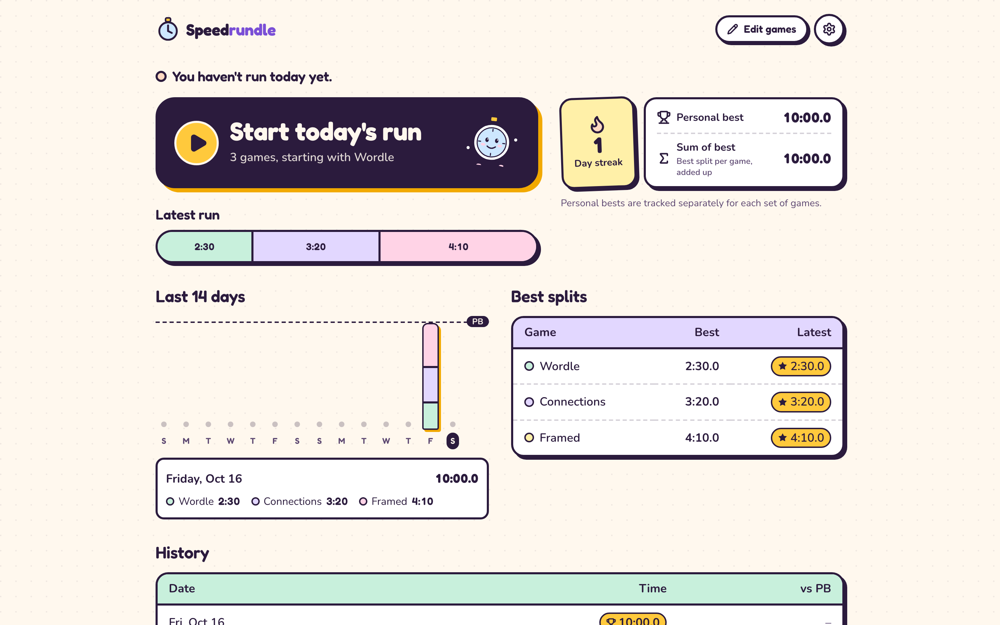
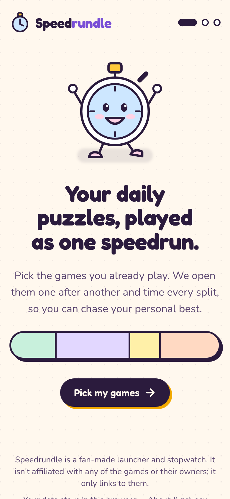
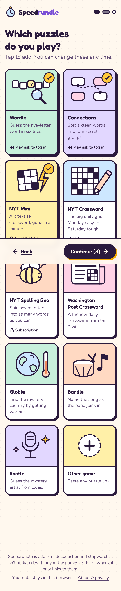
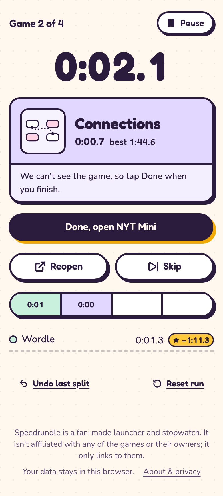

# Speedrundle ⏱️

**Your daily puzzles, played as one speedrun.**

Pick the daily puzzle games you already play: Wordle, Connections, NYT Mini, Spelling Bee, Globle and more. Press **Start** and Speedrundle opens each game in a new tab, one after another, timing every split. It keeps your streak, personal bests, best splits and sum of best, the way speedrunners do.



<p>
  
  
  
</p>

## Features

- **Onboarding in three steps.** No sign-up: pick your games and go.
- **Game picker.** Each game gets an original illustration and a badge if it needs a login or subscription. The **Other** card adds any game by link. Reorder games by drag, keyboard or arrow buttons.
- **Run mode.** One button records your split and opens the next game. You can reopen, skip, pause, undo and reset (with confirmation), so you're never stuck. The site can't see inside the games, so you tap **Done** when you finish.
- **Records:**
  - the day streak;
  - a personal best for each set of games, like a speedrun category;
  - your best split per game;
  - sum of best;
  - a 14-day chart and a history table.
- **Celebrations.** New bests turn gold, and a new PB gets confetti, unless the system asks for reduced motion.
- **Private by design.** Everything lives in your browser's `localStorage`. There are no accounts, cookies, analytics or server. Settings lets you download a backup, restore by merging or replacing, and erase everything.

### Included games

| Game | Link | Access |
|---|---|---|
| Wordle | nytimes.com/games/wordle | Free (may ask you to log in) |
| Connections | nytimes.com/games/connections | Free (may ask you to log in) |
| NYT Mini | nytimes.com/crosswords/game/mini | Subscription |
| NYT Crossword | nytimes.com/crosswords/game/daily | Subscription |
| NYT Spelling Bee | nytimes.com/puzzles/spelling-bee | Subscription |
| Washington Post Crossword | washingtonpost.com/games/crossword | Free |
| Minute Cryptic | minutecryptic.com | Free |
| Globle | globle-game.com | Free |
| Bandle | bandle.app | Free |
| Spotle | spotle.io | Free |

Links and access were checked in a real browser on 2026-10-17. To add or fix a game, edit `lib/games.ts`.

## Tech

- [Next.js](https://nextjs.org) 16 (App Router) with `output: "export"`, built as a fully static site
- Tailwind CSS v4 and hand-written design tokens in `app/globals.css`
- [Zustand](https://zustand.docs.pmnd.rs) with `persist`, saving to `localStorage`
- [dnd-kit](https://dndkit.com) for accessible reordering, [lucide](https://lucide.dev) icons and [canvas-confetti](https://github.com/catdad/canvas-confetti)
- Vitest for unit tests, and Playwright with axe-core for end-to-end and accessibility tests

```
app/          routes: / (onboarding), /dashboard, /games, /settings, /about
components/   GameCard, GamePicker, SplitStrip, HistoryChart, RunPanel, ResultPanel, Mascot, illustrations…
lib/          games catalog, timing engine, stats, store, import/export, strings
tests/        unit (timing, stats, backups, URL validation) and e2e (full flow + axe)
```

All user-facing copy lives in `lib/strings.ts`, ready for translation. The visual system is documented in [`DESIGN.md`](DESIGN.md).

## Getting started

```bash
npm install
npm run dev            # http://localhost:3000
```

| Command | What it does |
|---|---|
| `npm test` | Unit tests (Vitest) |
| `npm run build` | Static export into `out/` |
| `npm run test:e2e` | End-to-end flow and accessibility checks on phone and desktop (run `npm run build` first) |
| `npm run lint` | ESLint |

Run `npx playwright install chromium` once before the first end-to-end run.

## Deploy to Netlify (free)

**From GitHub (recommended):** in Netlify, choose Add new site → Import an existing project and pick this repo. `netlify.toml` already sets the build command (`npm run build`), the publish folder (`out`) and Node 24. Every push redeploys.

**Drag and drop:** run `npm run build` and drop the `out/` folder on https://app.netlify.com/drop. For link previews with an image, build with `URL=https://your-site.netlify.app npm run build`.

Each person who opens the site gets their own games and records in their own browser.

## Disclaimer

Speedrundle is a fan-made launcher and stopwatch. It is not affiliated with, endorsed by or connected to The New York Times, The Washington Post, or the makers of any game it links to. It only links out: it never embeds, scrapes or copies a game. Game names belong to their owners. All illustrations are original.
